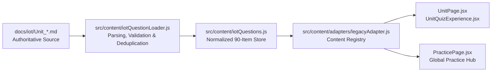

# EduTech IoT Question Architecture & Authoring Manual

## 1. Overview & Single Source of Truth

The **EduTech Diploma Learning Hub** features a centralized, verified question bank for all six Internet of Things (IoT) units.
Every question is loaded dynamically through the reusable loader system without hardcoded counts or duplicated quiz implementations.

### 1.1 Question Inventory Summary

| Unit | Title | Source Markdown File | Total MCQs | Verified PYQs | Syllabus Practice | Verified Exam Sessions |
| :---: | :--- | :--- | :---: | :---: | :---: | :--- |
| **1** | **Introduction to IoT** | `docs/iot/Unit_1_Introduction_to_IoT.md` | **15** | **15** | 0 | Mar 2023, Jan 2024, Dec 2024, Jan 2026 |
| **2** | **IoT Protocols** | `docs/iot/Unit_2_IoT_Protocols.md` | **15** | **15** | 0 | Mar 2023, Jan 2024, Dec 2024, Jan 2026 |
| **3** | **IoT Architecture** | `docs/iot/Unit_3_IoT_Architecture.md` | **15** | 0 | **15** | *None in past board papers* |
| **4** | **Web of Things (WoT)** | `docs/iot/Unit_4_Web_of_Things_WoT.md` | **15** | **1** | **14** | Mar 2023, Dec 2024 |
| **5** | **Arduino** | `docs/iot/Unit_5_Arduino.md` | **15** | **5** | **10** | Mar 2023, Jan 2024, Dec 2024 |
| **6** | **IoT Applications** | `docs/iot/Unit_6_IoT_Applications.md` | **15** | **3** | **12** | Mar 2023, Jan 2024, Dec 2024, Jan 2026 |
| **TOTAL** | **All 6 IoT Units** | | **90** | **39** | **51** | **4 Board Exam Sessions** |

---

## 2. Question Data Format & Schema

Each question adheres to the normalized schema defined in `src/content/iotQuestions.js` and `src/content/iotQuestionLoader.js`:

```javascript
{
  id: "iot-u2-q1",                              // Unique stable ID (iot-u<unitId>-q<number>)
  subjectId: "iot",                             // Always 'iot' for this subject
  unitId: 2,                                    // Unit number (1 to 6)
  qNum: 1,                                      // Question order in unit
  question: "What is the full form of MQTT?",   // Clean, unambiguous question text
  options: [                                    // Exactly 4 options
    "Message Queuing Telemetry Transport",
    "Media Query Transport",
    "Multiple Queue Terminal Transfer",
    "Mobile Quality Transport"
  ],
  correctAnswer: 0,                             // 0-indexed integer (0 for A, 1 for B, 2 for C, 3 for D)
  answer: "Message Queuing Telemetry Transport", // Explicit text of the correct choice
  explanation: "MQTT is a lightweight messaging protocol used in IoT.",
  sourceType: "pyq",                            // 'pyq' (verified past paper) or 'practice'
  years: ["Mar 2023", "Dec 2024"],              // Array of verified sessions
  year: "Mar 2023, Dec 2024",                   // Comma-separated display string
  pyq: "PYQ — Mar 2023, Dec 2024",              // High-contrast badge citation
  note: null,                                   // Optional teacher clarification note
  sourceFile: "Unit_2_IoT_Protocols.md"         // Origin file for traceability
}
```

---

## 3. How to Add a New MCQ to a Unit

### Step 1: Open the Unit's Markdown File
Navigate to `docs/iot/` and open the corresponding unit file (e.g. `docs/iot/Unit_2_IoT_Protocols.md`).

### Step 2: Add the Question Block in Section A
Follow the standard markdown structure:

```markdown
### MCQ 16. Which port does secure MQTT over TLS normally use?
**PYQ — Jan 2026**
- **A.** 1883
- **B.** 8883
- **C.** 80
- **D.** 443

**Answer:** B. 8883  
**Explanation:** Standard MQTT uses TCP port 1883, while encrypted MQTT over TLS uses port 8883.
*Note: Optional teacher nuance note.*
```

### Step 3: Source Labeling Rules
- **For Verified PYQs:** Use `**PYQ — <Session(s)>**` (e.g. `**PYQ — Mar 2023, Jan 2026**`).
- **For Syllabus Practice:** Use `**Practice — Not verified PYQ**`.
- **Never fabricate exam years.** If an item did not appear in past council papers, label it as Practice.
- If an item appeared in multiple years, list them separated by commas. **Do not duplicate the question.**

### Step 4: Re-run Parity & Build Verification
Run the automated test runner:

```bash
npm run test:parity
```

The test runner will verify:
1. All questions belong strictly to the correct unit.
2. All options are non-empty and answer index resolves correctly.
3. Zero duplicate question IDs exist across the repository.

---

## 4. Architectural Data Flow



- **Frontend Isolation:** Neither `UnitPage.jsx` nor `QuizPlayer.jsx` hardcodes question arrays or counts. They dynamically query `getIotUnitQuestions(unitId)` and `getIotUnitStats(unitId)`.
- **Zero Content Drift:** `src/data/*.js` files remain protected under cryptographic SHA-256 byte-level locks.
